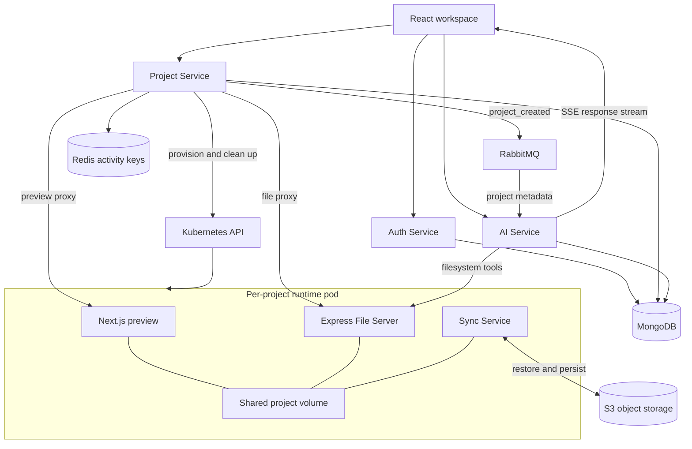

# ForgeFlow AI

**An AI-assisted coding workspace with streaming conversations, a browser-based editor, and Kubernetes-managed project runtimes.**

ForgeFlow AI brings project management, code editing, AI file tools, and application previews into one workspace. Its services communicate through HTTP, server-sent events, and RabbitMQ, while MongoDB stores application metadata, Redis tracks runtime activity, and S3 stores project files.

> **Project status:** development showcase for a local demo. The feature code is committed; full-system builds, security fixes, and end-to-end verification are still in progress. There is no hosted demo yet. See the [verification backlog](Lovable%20V2/docs/verification-backlog.md).

## Features

- **Account sessions:** registration, password login, signed access tokens, refresh cookies, logout, and profile retrieval.
- **Project workspace:** create and list owned projects, launch a runtime, and navigate between projects.
- **Browser editor:** Monaco-based editing, file exploration, tabs, keyboard saving, and file create, rename, move, and delete flows.
- **AI conversations:** project-scoped conversation history, streamed assistant text, cancellation, and error states.
- **Filesystem tools:** the coding agent can inspect the runtime file tree and read, create, update, or delete files through structured tools.
- **Application preview:** an embedded Next.js preview with refresh and external-open controls.
- **Runtime lifecycle:** per-project Kubernetes pods and services, shared file volumes, Redis activity tracking, and idle-resource cleanup.
- **File persistence:** startup restore from S3 and debounced synchronization of runtime file changes.

These describe the implemented code paths; they are not a claim that every integration has passed runtime verification.

## Technology stack

| Area | Technologies |
| --- | --- |
| Workspace UI | React 19, Vite, React Router, Tailwind CSS, Monaco Editor |
| Backend APIs | Node.js, Express 5, TypeScript, JWT, bcrypt |
| AI orchestration | LangChain/LangGraph, Mistral, Zod, structured filesystem tools |
| Application data | MongoDB and Mongoose |
| Service events | RabbitMQ / AMQP |
| Runtime activity | Redis, key-expiry notifications, pub/sub |
| Project execution | Kubernetes pods and services, Docker, Next.js |
| Project files | Shared runtime volume, Chokidar, AWS S3 SDK |
| Deployment configuration | Kubernetes manifests, NGINX ingress, RBAC, Skaffold |
| Local dependencies | Docker Compose, MongoDB, RabbitMQ, Redis, SeaweedFS S3-compatible storage |

## Architecture



### Service responsibilities

| Component | Responsibility | Main entry points |
| --- | --- | --- |
| [Auth Service](Lovable%20V2/auth-service) | Account validation, password hashing, session issuance, refresh, logout, and profile endpoints | `src/server.ts`, `src/routes/auth.routes.ts` |
| [Project Service](Lovable%20V2/project-service) | Owned project metadata, event publishing, runtime provisioning, proxying, and idle cleanup | `src/controllers`, `src/service` |
| [Express File Server](Lovable%20V2/express-file-server) | Runtime file tree and UTF-8 file operations | `src/routes/file.routes.ts`, `src/service/file.service.ts` |
| [Sync Service](Lovable%20V2/sync-service) | Project-scoped S3 objects, startup restore, filesystem watching, and batched persistence | `src/service/sync.service.ts`, `src/service/watcher.service.ts` |
| [AI Service](Lovable%20V2/ai-service) | Project event ingestion, conversations, message history, agent tools, and SSE responses | `src/controller/ai.controller.ts`, `src/service/ai` |
| [Next.js runtime](Lovable%20V2/nextjs-boilerplate) | Editable application template and development preview server inside each project runtime | `app`, `dockerfile` |
| [Frontend](Lovable%20V2/frontend) | Authentication screens, projects, editor, conversation UI, and preview controls | `src/pages`, `src/components/workspace` |

### How a project flows through the system

1. A user registers or signs in. The frontend sends the access token with authenticated API requests and uses the refresh cookie for session restoration.
2. The Project Service stores a project with its owner and publishes a `project_created` event. The AI Service consumes that event to establish its project context.
3. Launching a project creates a Kubernetes runtime pod and an internal service. The runtime template, file server, and sync process share the project volume.
4. The editor and AI tools work with runtime files through the file API. The preview server reads the same working directory.
5. The Sync Service restores saved project files at startup and batches subsequent filesystem changes into S3 operations.
6. Requests refresh the runtime's Redis activity key. Expiry notifications trigger pod/service teardown and reset the project's runtime state.

## Repository structure

There are **seven independent npm packages**, each with its own `package.json` and `package-lock.json`. Run package commands inside the relevant directory; there is no root npm workspace.

```text
forgeflow-ai/
├── README.md
├── .gitignore
└── Lovable V2/
    ├── auth-service/
    │   ├── src/
    │   │   ├── app/                # Express application factory
    │   │   ├── config/             # Environment and MongoDB connection
    │   │   ├── controller/         # Registration, login, refresh, logout, profile
    │   │   ├── DAO/                # User persistence operations
    │   │   ├── middlewares/        # Bearer authentication and errors
    │   │   ├── models/             # User schema
    │   │   ├── routes/
    │   │   ├── types/
    │   │   └── utils/              # Refresh-cookie configuration
    │   └── test/                   # Endpoint checks and regression cases
    ├── project-service/
    │   └── src/
    │       ├── app/
    │       ├── config/             # MongoDB, Redis, environment
    │       ├── controllers/
    │       ├── middlewares/
    │       ├── models/
    │       ├── routes/
    │       └── service/            # Broker, Kubernetes, activity, project lifecycle
    ├── express-file-server/
    │   └── src/
    │       ├── app/
    │       ├── config/
    │       ├── controllers/
    │       ├── routes/
    │       ├── service/            # Tree, read, write, delete
    │       └── utils/              # Paths and filename query parsing
    ├── sync-service/
    │   └── src/
    │       ├── config/             # Storage credentials, project prefix, limits
    │       ├── service/            # S3 transfers, bootstrap, watcher queue
    │       └── utils/              # Filtering, relative paths, concurrency
    ├── ai-service/
    │   └── src/
    │       ├── app/
    │       ├── config/
    │       ├── controller/         # Conversation/history endpoints and SSE
    │       ├── middlewares/
    │       ├── models/             # Projects, conversations, messages, tool calls
    │       ├── routes/
    │       └── service/
    │           ├── broker.service.ts
    │           └── ai/            # Agent, instructions, tools, title generation
    ├── nextjs-boilerplate/
    │   ├── app/                    # Root layout, page, styles
    │   ├── public/
    │   └── dockerfile
    ├── frontend/
    │   └── src/
    │       ├── api/                # HTTP clients and SSE transport
    │       ├── auth/               # Session context and restoration
    │       ├── components/
    │       │   └── workspace/      # Explorer, Monaco editor, chat, preview
    │       ├── pages/              # Authentication, projects, workspace
    │       └── utils/
    ├── k8s/                        # Deployments, services, ingress, RBAC, secret template
    ├── tools/setup-local.mjs       # Generate ignored local configuration
    ├── compose.local.yml           # Supporting data services
    ├── skaffold-eks.yaml            # Container build and manifest orchestration
    ├── loveable.excalidraw          # Editable system diagram
    └── docs/                       # Commit guide, progress, verification backlog
```

## API overview

| Service | Method and path | Purpose |
| --- | --- | --- |
| Auth | `POST /api/auth/register` | Create an account and session |
| Auth | `POST /api/auth/login` | Verify credentials and issue a session |
| Auth | `POST /api/auth/refresh` | Renew tokens using the refresh cookie |
| Auth | `POST /api/auth/logout` | Clear session state and the cookie |
| Auth | `GET /api/auth/me` | Return the authenticated profile |
| Projects | `GET /api/projects` | List the caller's projects |
| Projects | `POST /api/projects` | Create a project and publish its event |
| Projects | `POST /api/projects/:projectId/launch` | Start a project runtime |
| AI | `GET /api/ai/projects/:projectId/conversations` | List project conversations |
| AI | `POST /api/ai/projects/:projectId/conversations` | Create a conversation |
| AI | `GET /api/ai/conversations/:conversationId/messages` | Retrieve readable message history |
| AI | `POST /api/ai/message` | Stream `meta`, `token`, `done`, or `error` SSE events |
| Runtime files | `GET /file-tree` | Return the file tree |
| Runtime files | `GET /files?filenames=...` | Read selected files |
| Runtime files | `POST /files`, `PATCH /files`, `DELETE /files` | Create, replace, or remove files |

The file routes belong to the runtime sidecar, not a standalone public API. Gateway authorization and path-protection issues are part of the verification backlog.

## Local development

### Requirements

- Node.js 22.12+ and npm; use each package's lockfile with `npm ci`.
- Docker with Compose for supporting dependencies.
- A disposable Kubernetes context for the complete runtime lifecycle.
- A Mistral API key for real model calls and storage credentials for S3 operations.
- Enough memory for the data services and multi-container project runtimes; the current runtime pod requests about 1.75 GiB before infrastructure overhead.

### 1. Clone and install packages

```powershell
git clone https://github.com/tarun5004/forgeflow-ai.git
cd forgeflow-ai
cd "Lovable V2"

$packages = @(
  "auth-service", "project-service", "express-file-server",
  "sync-service", "ai-service", "nextjs-boilerplate", "frontend"
)
foreach ($package in $packages) {
  Push-Location $package
  npm ci
  Pop-Location
}
```

### 2. Configure local dependencies

```powershell
node tools/setup-local.mjs
docker compose -f compose.local.yml up -d
```

The setup tool generates random local passwords/JWT secrets and writes ignored environment files without overwriting files that already exist. Set `MISTRAL_API_KEY` in the ignored `ai-service/.env` before starting the AI Service. Set `LANGSMITH_TRACING=false` for local work unless you intentionally configure tracing.

| Dependency | Host endpoint |
| --- | --- |
| MongoDB | `127.0.0.1:17017` |
| RabbitMQ AMQP | `127.0.0.1:15673` |
| RabbitMQ management | `http://127.0.0.1:15674` |
| Redis | `127.0.0.1:16379` |
| Local S3-compatible storage | `http://127.0.0.1:19000` |

Compose starts supporting dependencies; it does not launch all application services or configure Kubernetes. The Sync Service's optional local S3 endpoint adapter is still pending, so the Compose storage endpoint is not yet a complete sync setup.

### 3. Start individual development services

From separate terminals, run `npm run dev` inside `auth-service`, `project-service`, `ai-service`, and `frontend`. The generated configuration selects Auth port `14000` and Project port `13000`. The AI server currently listens on `3001` even though the helper writes `PORT=13001`; that mismatch is tracked for the verification phase.

The file server, sync worker, and Next.js application normally run together in each project runtime. For direct file-server work, configure `WORK_FOLDER` before starting it. The sync worker additionally needs `PROJECT_ID`, `AWS_ACCESS_KEY_ID`, `AWS_SECRET_ACCESS_KEY`, `S3_BUCKET`, and `AWS_REGION` in its process environment.

### 4. Complete the runtime and gateway configuration

Before attempting the full browser flow:

- Point container image references in the runtime service and deployment configuration at images available to your local cluster.
- Select a disposable context with the required pod/service permissions. The Project Service loads Kubernetes configuration from the default SDK resolution path; use `KUBECONFIG` to select the intended local configuration explicitly.
- Configure ingress/gateway routes for `/api/auth`, `/api/projects`, `/api/ai`, preview hosts, and file hosts. The frontend's Vite proxy currently targets `http://localhost` on port 80.
- Keep real values out of `k8s/secrets.example.yml`; create the ignored secret manifest/configuration locally.
- Address the known file-routing, authorization, refresh-token, and sync-reliability findings before exposing the system beyond localhost.

These are development setup steps, not a verified one-command demo recipe. No AWS deployment is required for the intended local showcase.

## Verification

Run checks from the relevant package directory:

| Package | Available commands |
| --- | --- |
| Auth | `npm run build`, `npm test` |
| Project | `npm run build` |
| AI | `npm run build` |
| Express File Server | `npm run build` |
| Sync | `npm run build` |
| Next.js runtime | `npm run build`, `npm run lint` |
| Frontend | `npm run build`, `npm run lint` |

Some backend `test` scripts are placeholders. The Auth regression suite includes known failing cases; full-project checks have not been completed. A previously attempted real-provider request returned HTTP 429, so successful AI generation and the complete browser-to-storage flow remain unverified.

Use the [verification backlog](Lovable%20V2/docs/verification-backlog.md) for the ordered feature checks and known issues, and the [commit guide](Lovable%20V2/docs/commit-guide.md) to navigate functional changes.

## Engineering topics demonstrated

- Separating authentication, project lifecycle, runtime file operations, persistence, and AI orchestration into service boundaries.
- Connecting synchronous HTTP flows with asynchronous project events and streamed AI responses.
- Mapping a project to Kubernetes resources and coordinating their lifetime with Redis activity keys.
- Sharing one filesystem between an editor API, a preview application, and a persistence worker.
- Representing AI tool calls and conversation history independently from user-visible chat text.
- Using focused feature commits and documenting verification limits alongside the implementation.
